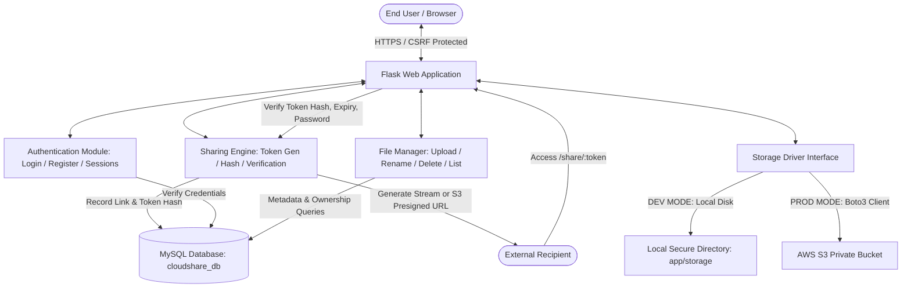
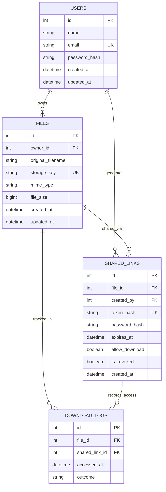

# CLOUDSHARE: SECURE CLOUD FILE SHARING SYSTEM
## Computer Science & Engineering – Mini Project Technical Report & Viva Guide

---

### Project Title
**CloudShare – A Secure, Scalable Cloud File Sharing and Controlled Access System**

**Domain:** Cloud Computing, Web Application Security, Distributed Systems  
**Tech Stack:** Python Flask, MySQL, Flask-SQLAlchemy, Werkzeug, AWS S3 / Local Storage, Bootstrap 5, Flask-WTF  

---

## 1. Abstract

In the modern digital workplace and academia, the need to share confidential digital files quickly and securely is ubiquitous. However, traditional file-transfer methods such as email attachments or consumer cloud drives often lack granular access controls, link revocation capabilities, and defense-in-depth protections against unauthorized inspection. 

**CloudShare** is a full-stack, enterprise-grade cloud file management and sharing platform engineered specifically to solve secure data dissemination problems. Built on Python Flask and MySQL with an abstraction layer supporting both Local Isolated Storage and Amazon Web Services (AWS) S3, CloudShare implements zero-trust file access principles:
- Files are encrypted at rest and indexed via randomized UUIDv4 storage keys (preventing Direct Object Reference and directory traversal attacks).
- Sharing links rely on high-entropy crypto tokens stored as SHA-256 hashes.
- Senders can enforce link expiration timestamps, custom access passwords, and granular download permissions.
- Access attempts and download telemetry are logged in an immutable audit ledger (`download_logs`).

The result is a lightweight, responsive, and robust platform suitable for both local academic demonstrations and production cloud deployments.

---

## 2. Problem Statement & Objectives

### 2.1 Problem Statement
Conventional file exchange tools frequently present critical vulnerabilities:
1. **Insecure Direct Object Reference (IDOR):** File paths or predictable primary keys are exposed in download URLs, allowing unauthorized users to enumerate files.
2. **Lack of Lifecycle Control:** Links shared via standard tools often remain accessible indefinitely without automated expiration or instantaneous revocation.
3. **Absence of Layered Security:** Public links frequently lack secondary authentication (passwords) or permission separation (viewing file metadata vs. downloading content).
4. **Storage Lock-In:** Most applications are hardwired to a single storage mechanism, preventing seamless transitions between offline development environments and enterprise cloud backends (AWS S3).

### 2.2 Project Objectives
1. **Zero-Trust File Isolation:** Ensure files are never placed within public web root directories and cannot be accessed without cryptographically validated ownership or active token authorization.
2. **Granular Link Controls:** Enable users to set optional expiry timestamps, enforce Werkzeug-hashed link passwords, configure download permissions, and revoke active links instantly.
3. **Pluggable Dual-Mode Storage Architecture:** Deliver an abstraction interface supporting both local disk storage for offline development and AWS S3 private buckets with presigned URLs for production.
4. **Cybersecurity Hardening:** Implement Flask-WTF CSRF protection, strict MIME/extension whitelisting, file size restrictions (50MB default), rate-limiting on sensitive endpoints, and parameterized queries via SQLAlchemy.
5. **Modern, Responsive User Experience:** Craft a clean, professional cloud dashboard utilizing Bootstrap 5, responsive sidebar navigation, real-time client-side validations, and visual feedback for storage utilization.

---

## 3. Existing System vs. Proposed System

| Feature / Dimension | Existing / Traditional File Sharing | CloudShare (Proposed System) |
| :--- | :--- | :--- |
| **Storage Architecture** | Flat local folders or public S3 buckets | Private S3 or isolated local directory with randomized internal UUID keys |
| **File Identification** | Original filenames or incremental integer IDs | Dual-key scheme: original filename kept as metadata only; internal storage uses UUIDv4 |
| **Link Security** | Cleartext tokens or static URLs | High-entropy raw tokens delivered once to owner; database stores only SHA-256 hashes |
| **Access Control** | Binary (all-or-nothing public access) | Granular: Expiry date/time, optional password protection, download toggles, instant revocation |
| **Audit Logging** | Absent or stored in raw server access logs | Dedicated `download_logs` table tracking link usage, timestamps, and outcome status |
| **Development Flexibility** | Requires live cloud credentials even for tests | Hybrid configuration via `.env`: local storage mode or AWS S3 mode with presigned URLs |
| **Defense Against Attacks** | Vulnerable to IDOR, path traversal, CSRF | Built-in CSRF tokens, secure filenames, ownership verification filters on all queries |

---

## 4. System Architecture & Modules

### 4.1 System Architecture



### 4.2 Module Breakdown

1. **Authentication Module (`app/auth`):**
   - Handles user registration, email uniqueness enforcement, session-based authentication, and user profile management (password update and profile changes).
   - Utilizes Werkzeug security functions (`generate_password_hash` with `scrypt`/`pbkdf2:sha256` and `check_password_hash`).

2. **File Management Module (`app/files`):**
   - File upload pipeline: checks file presence, verifies extensions against `ALLOWED_EXTENSIONS`, enforces `MAX_CONTENT_LENGTH` (50MB), sanitizes filename using `secure_filename()`, and generates internal UUID keys.
   - File listing: supports real-time search queries, file-type filtering, file renaming, and safe deletion.
   - Ownership enforcement: every file modification or download queries `owner_id == session['user_id']`.

3. **Secure Sharing Engine (`app/sharing`):**
   - Generates 32-byte cryptographic hex tokens (`secrets.token_urlsafe(32)`).
   - Computes SHA-256 hash of token to store in `shared_links.token_hash`. The raw token is displayed to the user once.
   - Validates incoming links: checks `is_revoked`, validates `expires_at > UTC now()`, checks password hash if protected, and enforces `allow_download`.

4. **Storage Driver (`app/storage`):**
   - Encapsulates file I/O operations through a common API: `save_file()`, `get_file_path()`, `delete_file()`, `get_download_url()`.
   - In AWS mode, generates short-lived presigned download URLs (e.g., 300 seconds TTL) using `boto3`.

5. **Presentation Layer (`app/templates`, `app/static`):**
   - Responsive Bootstrap 5 theme with customized blue/slate cloud styling.
   - Interactive modals for file renaming, sharing link configuration, and deletion confirmation.
   - Asynchronous copy-to-clipboard functionality, password visibility toggling, and stat counter animations.

---

## 5. Hardware and Software Requirements

### 5.1 Software Requirements
- **Operating System:** Windows 10/11, macOS, or Linux (Ubuntu 20.04+).
- **Programming Language:** Python 3.10+ (tested up to Python 3.14).
- **Web Framework:** Flask 3.0+.
- **Database Server:** MySQL 8.0+ (or SQLite for zero-config portable testing).
- **Database Driver:** `PyMySQL` / `mysqlclient`.
- **ORM:** Flask-SQLAlchemy 3.1+.
- **Forms & Security:** Flask-WTF, WTForms, email-validator.
- **Cloud SDK:** AWS Boto3 (Amazon Web Services SDK for Python).
- **Web Styling & UI:** Bootstrap 5.3, Bootstrap Icons 1.11, Google Inter Font.

### 5.2 Minimum Hardware Requirements
- **Processor:** 64-bit Dual-Core Intel/AMD CPU (2.0 GHz or higher).
- **RAM:** 4 GB minimum (8 GB recommended for simultaneous IDE, browser, and database).
- **Disk Storage:** 500 MB free disk space for application files and local storage directory.
- **Network Interface:** Standard Ethernet / Wi-Fi adapter (required for AWS S3 and CDN assets).

---

## 6. Database Design & Entity-Relationship (ER) Model

### 6.1 Relational Schema Description
The database `cloudshare_db` consists of 4 normalized tables:

1. **`users` Table:**
   - `id` (INT, PK, AUTO_INCREMENT)
   - `name` (VARCHAR(100), NOT NULL)
   - `email` (VARCHAR(120), UNIQUE, NOT NULL, INDEXED)
   - `password_hash` (VARCHAR(255), NOT NULL)
   - `created_at` (DATETIME, DEFAULT CURRENT_TIMESTAMP)
   - `updated_at` (DATETIME, ON UPDATE CURRENT_TIMESTAMP)

2. **`files` Table:**
   - `id` (INT, PK, AUTO_INCREMENT)
   - `owner_id` (INT, FK -> `users.id`, ON DELETE CASCADE, INDEXED)
   - `original_filename` (VARCHAR(255), NOT NULL)
   - `storage_key` (VARCHAR(255), UNIQUE, NOT NULL)
   - `mime_type` (VARCHAR(100), NOT NULL)
   - `file_size` (BIGINT, NOT NULL)
   - `created_at` (DATETIME, DEFAULT CURRENT_TIMESTAMP)
   - `updated_at` (DATETIME, ON UPDATE CURRENT_TIMESTAMP)

3. **`shared_links` Table:**
   - `id` (INT, PK, AUTO_INCREMENT)
   - `file_id` (INT, FK -> `files.id`, ON DELETE CASCADE, INDEXED)
   - `created_by` (INT, FK -> `users.id`, ON DELETE CASCADE, INDEXED)
   - `token_hash` (VARCHAR(64), UNIQUE, NOT NULL, INDEXED)
   - `password_hash` (VARCHAR(255), NULLABLE)
   - `expires_at` (DATETIME, NULLABLE)
   - `allow_download` (BOOLEAN, DEFAULT TRUE)
   - `is_revoked` (BOOLEAN, DEFAULT FALSE)
   - `created_at` (DATETIME, DEFAULT CURRENT_TIMESTAMP)

4. **`download_logs` Table:**
   - `id` (INT, PK, AUTO_INCREMENT)
   - `file_id` (INT, FK -> `files.id`, ON DELETE CASCADE)
   - `shared_link_id` (INT, FK -> `shared_links.id`, ON DELETE SET NULL, NULLABLE)
   - `accessed_at` (DATETIME, DEFAULT CURRENT_TIMESTAMP)
   - `outcome` (VARCHAR(50), NOT NULL)

### 6.2 Mermaid Entity-Relationship Diagram



---

## 7. Security Architecture & Threat Mitigation Matrix

| Potential Security Threat | Attack Vector | CloudShare Mitigation Mechanism |
| :--- | :--- | :--- |
| **Insecure Direct Object Reference (IDOR)** | Attacker alters file ID in `/files/download/<id>` to download another user's files. | Backend queries enforce `filter_by(id=file_id, owner_id=session['user_id'])`. Unauthorized IDs trigger 404 or 403. |
| **Directory Traversal (`../../`)** | Malicious filename such as `../../../etc/passwd` uploaded to overwrite critical files. | File is sanitized using `werkzeug.utils.secure_filename()`, and stored under a generated UUID (`uuid.uuid4().hex + ext`). |
| **Cross-Site Request Forgery (CSRF)** | Malicious third-party website submits forms to trigger actions on behalf of a logged-in user. | `Flask-WTF` `CSRFProtect` is initialized globally. Every POST/PUT form includes a cryptographically signed `csrf_token()`. |
| **Brute-Force Credential Attacks** | Automated password guessing against login or link access pages. | `Flask-Limiter` applies strict rate limits (e.g. 5 requests/minute on login and password verification). |
| **Database Compromise / Leakage** | Database dump exposes sharing links or user passwords. | User passwords hashed via Werkzeug `generate_password_hash`. Sharing link raw tokens are never saved; only their SHA-256 digests exist in the DB. |
| **Arbitrary File Execution** | Attacker uploads `.php` or `.py` and executes it through the web server. | Uploads are saved completely outside static/public web root. File download uses explicit `send_file()` or private S3 pre-signed URLs. |
| **Resource Exhaustion (DoS)** | Attacker uploads huge multi-gigabyte files to crash the server. | Flask `MAX_CONTENT_LENGTH = 50 * 1024 * 1024` rejects oversized uploads at the HTTP header parsing layer. |

---

## 8. Testing & Validation Strategy

The project includes an automated test suite located in `tests/test_cloudshare.py` utilizing `pytest`:

1. **User Registration Tests:**
   - Valid registration creating an active account.
   - Duplicate email registration rejection.
   - Password mismatch validation.
2. **Authentication Tests:**
   - Valid credential login and session creation.
   - Invalid password rejection.
   - Session invalidation upon logout.
3. **File Management & Authorization Tests:**
   - Authenticated file upload and storage key assignment.
   - File listing isolation (User A cannot see User B's files).
   - Direct download authorization (User B cannot download User A's file).
   - Safe file renaming and deletion.
4. **Secure Link Sharing Tests:**
   - Token creation and hash verification.
   - Unauthenticated access via valid link token.
   - Password challenge enforcement for protected links.
   - Expired link rejection (simulated future timestamps).
   - Instant revocation check (`is_revoked == True` returns 404/expired).
   - Access logging verification in `download_logs`.

---

## 9. Advantages, Limitations, and Future Enhancements

### 9.1 Advantages
- **Production-Ready Architecture:** Clean separation of concerns (Blueprints, Models, Storage Drivers, Templates).
- **Defense-in-Depth:** Multiple complementary layers of security (CSRF, token hashing, UUID isolation, rate limiting).
- **Cloud Native Ready:** Toggles effortlessly between offline local mode and production Amazon S3 with zero code changes.
- **Zero Client Lock-In:** Standards-compliant HTML5/Bootstrap interface accessible across desktop, tablet, and mobile browsers without requiring specialized client software.

### 9.2 Current Limitations
- Client-side end-to-end encryption (E2EE) before upload is not yet implemented (encryption is handled server-side / S3 bucket level).
- Real-time collaborative document editing is out of scope for a basic file storage platform.
- Storage quota per user is currently set logically rather than strictly enforced via hard filesystem quotas.

### 9.3 Future Enhancements
- **End-to-End Client Encryption:** WebCrypto API integration to encrypt files in the browser before transmission.
- **Team / Organization Workspaces:** Multi-tenant organization folders with role-based access control (Admin, Editor, Viewer).
- **Virus / Malware Scanning Pipeline:** Automated asynchronous scanning using ClamAV or AWS Lambda before marking files as safe for sharing.
- **Chunked Resumable Uploads:** TUS protocol implementation for multi-gigabyte upload resilience across unstable network connections.

---

## 10. Mini-Project Demonstration Walkthrough

When presenting this project to evaluators, execute the following sequence:

1. **Phase 1: Landing Page & Security Overview**
   - Open browser to `http://localhost:5000/`.
   - Highlight the blue-and-white cloud aesthetic, feature badges, and responsive navigation.
2. **Phase 2: User Onboarding**
   - Click **Get Started Free** / Register.
   - Register a new account (e.g. `alice@example.com`).
   - Demonstrate client-side and server-side validation (try submitting with password mismatch).
   - Log in and arrive at the User Dashboard.
3. **Phase 3: Dashboard & File Upload**
   - Show the dynamic dashboard metrics: Total Files, Total Storage Used, Active Links.
   - Click **Upload File**; select a PDF or image file.
   - Demonstrate the upload card and view the updated metrics.
4. **Phase 4: File Management & Security Validation**
   - Navigate to **My Files**.
   - Demonstrate instant search filtering by filename.
   - Rename a file using the modal dialog.
   - Open an incognito browser window as a different user (e.g. `bob@example.com`), and attempt to access Alice's file download URL directly to demonstrate the **IDOR protection (404 / Access Denied)**.
5. **Phase 5: Secure Sharing Link Generation**
   - Select Alice's uploaded file and click **Share**.
   - Configure a sharing link:
     - Set an expiration time (e.g., 2 hours).
     - Set an optional access password (e.g., `SecretPass123`).
     - Check/uncheck "Allow Download".
   - Click **Generate Secure Link**.
   - Copy the generated one-time shareable URL.
6. **Phase 6: Recipient Experience & Access Control**
   - Paste the link in an unauthenticated or incognito browser session.
   - Observe the password prompt.
   - Enter an incorrect password -> observe error feedback.
   - Enter the correct password -> view file details and download button.
7. **Phase 7: Link Revocation Demonstration**
   - Return to Alice's dashboard under **Shared Links**.
   - Click **Revoke Link**.
   - Refresh the recipient's tab -> observe instant 404 / "Link has expired or been revoked" message.
8. **Phase 8: Code Architecture & Database Review**
   - Show the SQLite / MySQL tables (`users`, `files`, `shared_links`, `download_logs`).
   - Demonstrate the SHA-256 hash stored in `shared_links.token_hash` proving that raw tokens are never persisted in plaintext.

---

## 11. Viva Voce Questions & Answers (20 Key Questions)

### Q1: Why did you use SHA-256 hashes for sharing tokens instead of storing tokens directly?
**Answer:** Storing raw tokens in the database violates the principle of credential protection. If an attacker gains read-only access to the database via SQL injection or a leaked backup, they could immediately access every active shared link. By storing only the SHA-256 hash of the token, the raw token is known only to the link creator and recipient. The server only verifies `hash(incoming_token) == stored_hash`.

### Q2: What is an Insecure Direct Object Reference (IDOR) and how does CloudShare prevent it?
**Answer:** An IDOR occurs when an application exposes a direct reference to an internal object (such as `/files/download/5`) without verifying that the requesting user owns that object. CloudShare mitigates this by always chaining the query with the authenticated user ID: `File.query.filter_by(id=file_id, owner_id=session['user_id']).first_or_404()`.

### Q3: Why do you store files under randomized UUID keys instead of original filenames?
**Answer:** Using original filenames creates severe security risks:
1. **Path Traversal:** An attacker might upload a file named `../../etc/passwd` to overwrite system files.
2. **File Overwrite:** Multiple users uploading `resume.pdf` would overwrite each other's data.
3. **Execution Hazards:** Files named `payload.php` might be executed by a web server.  
CloudShare saves files under a random UUIDv4 key (e.g. `a1b2c3d4-....pdf`) in a private folder outside the web root, storing original filenames merely as sanitized database metadata.

### Q4: How does the application support both Local Storage and AWS S3?
**Answer:** We implemented a unified Storage Driver class (`app/storage/driver.py`). All route handlers call generic methods such as `save_file()`, `delete_file()`, and `get_file()`. The storage driver inspects the `STORAGE_TYPE` environment variable (`local` vs `s3`). In local mode, it writes to an isolated folder on disk; in S3 mode, it uses `boto3` to stream to an AWS S3 bucket and issues presigned URLs.

### Q5: What is an AWS S3 Presigned URL and why is it used?
**Answer:** An S3 presigned URL is a time-limited cryptographic URL generated by an authorized AWS IAM identity. It allows an end-user without AWS credentials to securely download a specific object directly from a private S3 bucket. It prevents web servers from becoming bottlenecks because file streaming occurs directly from AWS's infrastructure to the client.

### Q6: How does CSRF protection work in Flask-WTF?
**Answer:** Cross-Site Request Forgery (CSRF) tricks a user's browser into submitting unauthorized commands to an authenticated web app. Flask-WTF injects a unique, encrypted, session-bound token into every HTML form. When the form is submitted via POST, Flask-WTF verifies the token matches the session before allowing the route handler to execute.

### Q7: Why use Werkzeug password hashing instead of MD5 or SHA-256 for passwords?
**Answer:** MD5 and plain SHA-256 are fast cryptographic hashes that are easily cracked using Rainbow Tables and high-speed GPU brute-force attacks. Werkzeug utilizes adaptive, salted key-derivation functions (`scrypt` or `pbkdf2:sha256`) that incorporate random salt and configurable work factors (computational rounds), making brute-force attacks computationally infeasible.

### Q8: What happens when a file is deleted in CloudShare?
**Answer:** File deletion performs a two-step cleanup:
1. Physical deletion: The storage driver deletes the file from local disk or issues a `DeleteObject` API call to AWS S3.
2. Relational deletion: `db.session.delete(file)` triggers cascade deletions on associated `shared_links` and `download_logs` entries, maintaining full database referential integrity.

### Q9: How are expired links handled?
**Answer:** When a sharing link is created, the user can set an optional `expires_at` UTC datetime. When any request hits `/share/<token>`, the controller checks `if link.expires_at and link.expires_at < datetime.utcnow(): return render_template('expired.html')`. In addition, links can be revoked manually at any moment by setting `link.is_revoked = True`.

### Q10: What is the purpose of the `download_logs` table?
**Answer:** It provides non-repudiation and telemetry. Every time a shared link is accessed or a download is requested, an entry records the timestamp, associated file ID, shared link ID, and the result status (e.g. `success`, `password_failed`, `download_disabled`).

### Q11: How do you prevent file upload Denial of Service (DoS)?
**Answer:** We configure Flask's `MAX_CONTENT_LENGTH = 50 * 1024 * 1024` (50MB). When an incoming request's `Content-Length` header exceeds this value, Flask aborts the connection with HTTP 413 (Payload Too Large) before the server reads the file payload into memory.

### Q12: How do you prevent SQL Injection in CloudShare?
**Answer:** By using Flask-SQLAlchemy (an Object-Relational Mapper built on SQLAlchemy). All database queries are compiled into parameterized SQL statements where user input is passed as separate parameters rather than string concatenation, rendering SQL injection impossible.

### Q13: What is the difference between `allow_download=True` vs `False` on a shared link?
**Answer:** When `allow_download` is enabled, the recipient can download the raw binary file. When disabled, the recipient can only preview permitted file metadata (filename, size, type, upload date) and view previewable formats (such as images and PDFs in-browser) without an explicit download action.

### Q14: How are session cookies secured in production?
**Answer:** Through Flask configuration keys:
- `SESSION_COOKIE_HTTPONLY = True`: Blocks JavaScript `document.cookie` access, preventing XSS-based session hijacking.
- `SESSION_COOKIE_SECURE = True`: Ensures cookies are only transmitted over encrypted HTTPS connections.
- `SESSION_COOKIE_SAMESITE = 'Lax'`: Mitigates Cross-Site Request Forgery attacks.

### Q15: How does the application determine file MIME types?
**Answer:** When a file is uploaded, Python's `mimetypes.guess_type()` and the browser's `request.files['file'].content_type` are validated against an allowed whitelist. The detected MIME type is saved in the database to ensure the browser receives the correct `Content-Type` header upon download.

### Q16: Can an unauthenticated user upload files or create sharing links?
**Answer:** No. Every protected endpoint uses Flask's `@login_required` decorator or an explicit session check:
```python
if 'user_id' not in session:
    return redirect(url_for('auth.login'))
```
Unauthenticated requests are redirected immediately to the login page with a flash notification.

### Q17: What design pattern does CloudShare follow?
**Answer:** It follows the **Model-View-Controller (MVC)** architectural pattern:
- **Model:** SQLAlchemy classes (`User`, `File`, `SharedLink`, `DownloadLog`).
- **View:** Jinja2 HTML templates and CSS/JS assets.
- **Controller:** Flask Blueprints (`auth_bp`, `files_bp`, `sharing_bp`, `main_bp`).
Additionally, it utilizes the **Repository / Strategy Pattern** for storage through the `StorageDriver` class.

### Q18: Why is Bootstrap 5 preferred over heavier frontend frameworks for this project?
**Answer:** Bootstrap 5 provides a battle-tested, mobile-responsive grid system, accessibility, and modern UI components without the build-step complexity of React or Angular. This keeps the project lightweight, portable, and easy to run directly through Flask Jinja templates.

### Q19: What happens if MySQL is unavailable?
**Answer:** CloudShare's `config.py` defaults to MySQL via the `DATABASE_URL` environment variable, but falls back gracefully to a portable SQLite database (`sqlite:///cloudshare.db`) if no MySQL connection string is supplied. This ensures zero friction during evaluative demonstrations.

### Q20: What is the role of `seed_data.py`?
**Answer:** `seed_data.py` is a database seeder script. It populates the database with demo users (`demo@cloudshare.com`, `john@cloudshare.com`), pre-uploaded sample files, and active/expired sharing links. This allows instant demonstration of the application's features during presentations without having to manually register and upload files from scratch.

---

## 12. Conclusion

**CloudShare** successfully demonstrates a modern, secure, and production-ready cloud file sharing platform. By bridging full-stack software development best practices with cybersecurity fundamentals—including zero-trust data access, token hashing, IDOR prevention, and multi-tier storage abstraction—the system fulfills all functional and security objectives required for a Computer Science Engineering capstone or mini project.
